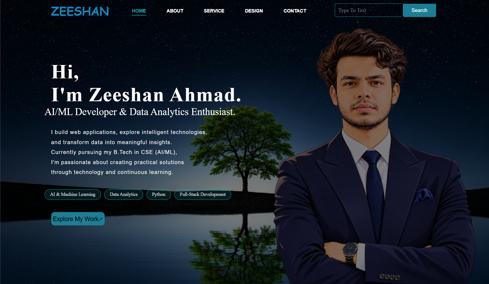
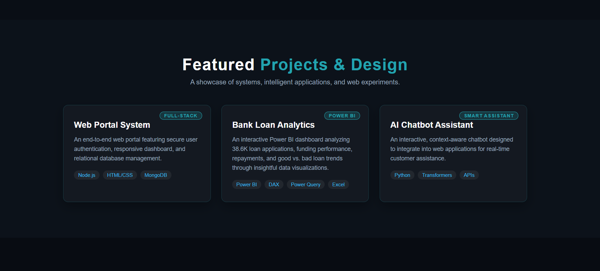

# ZEESHAN AHMED | Personal Portfolio

A personal portfolio website built using **HTML, CSS, and JavaScript** to showcase my profile, technical skills, experience, and projects.

## 🌐 Live Portfolio

- 🏠 [Visit Portfolio Homepage](https://zeeshanahmad03.github.io/Personal-Portfolio/)
- 💻 [Explore My Projects](https://zeeshanahmad03.github.io/Personal-Portfolio/#design)
## 📸 Website Preview

### Homepage



[View Homepage Screenshot](myportalhomepage.png)

### Projects Section



[View Projects Screenshot](projectdection.png)

## ✨ Features

- Responsive personal portfolio design
- Home and About sections
- Technical skills and professional experience
- Services and featured projects
- Interactive search functionality
- Contact form with EmailJS integration
- Mobile-friendly navigation
- Smooth scrolling and interactive elements
- Dark-themed interface with cyan highlights

## 🛠️ Technologies Used

- HTML5
- CSS3
- JavaScript
- EmailJS
- Ionicons

## 📂 Project Structure

```text
personal-portfolio/
│
├── README.md
├── index.html
├── style.css
├── script.js
│
├── myportalhomepage.png
└── projectdection.png
```

## 📄 Project Files

| File | Description |
|---|---|
| [index.html](index.html) | Website structure |
| [style.css](style.css) | Styling and responsive layout |
| [script.js](script.js) | Interactive functionality |
| [myportalhomepage.png](myportalhomepage.png) | Homepage screenshot |
| [projectdection.png](projectdection.png) | Projects section screenshot |

## 🚀 Run Locally

1. Clone the repository:

```bash
git clone https://github.com/zeeshanahmad03/personal-portfolio.git
```

2. Open the project folder.
3. Open `index.html` in your browser.

## 👨‍💻 About Me

I'm a B.Tech CSE (AI/ML) student interested in Artificial Intelligence, Machine Learning, Web Development, and Data Analytics.

I enjoy building practical projects and continuously improving my technical skills.

## 🔗 Connect With Me

- **GitHub:** [zeeshanahmad03](https://github.com/zeeshanahmad03)
- **LinkedIn:** [Connect with me](https://www.linkedin.com/in/iamzeeshan03)
- **Portfolio:** [Visit Website](https://zeeshanahmad03.github.io/personal-portfolio/)
---

⭐ If you like this project, feel free to explore it and share your feedback.

**Designed & Developed by**
**Zeeshan Ahmad**

B.Tech CSE (AI/ML) Student | Web Development | AI/ML | Data Analytics

If you find this project useful, feel free to explore the repository.

© 2026 Zeeshan Ahmad. All rights reserved.
